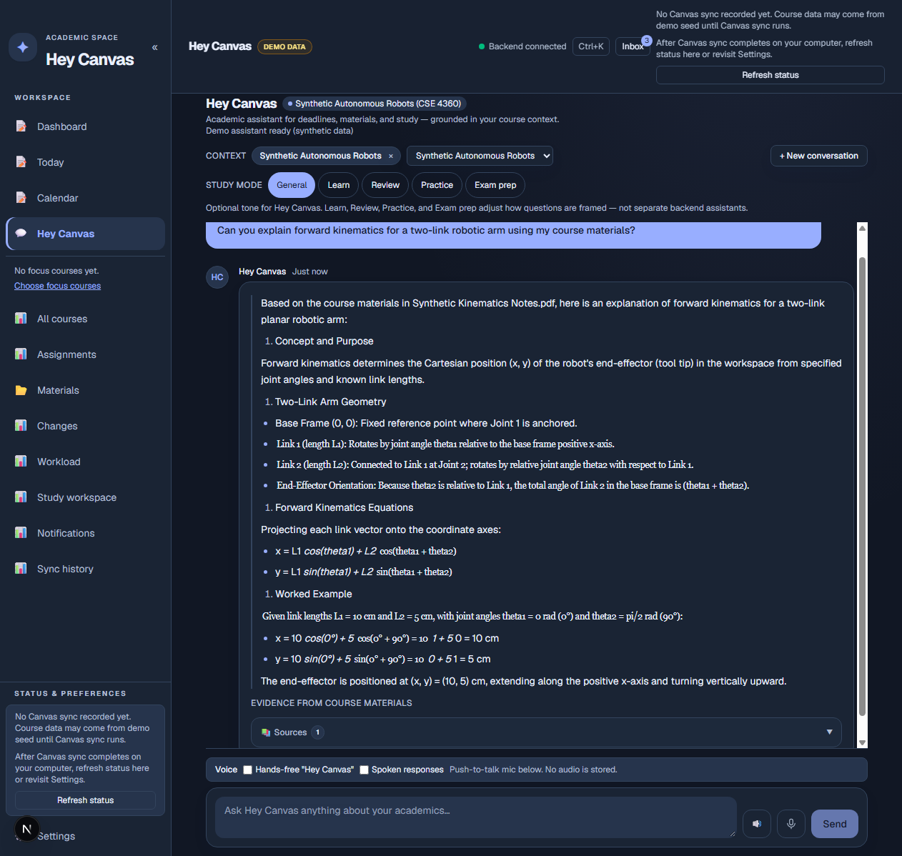
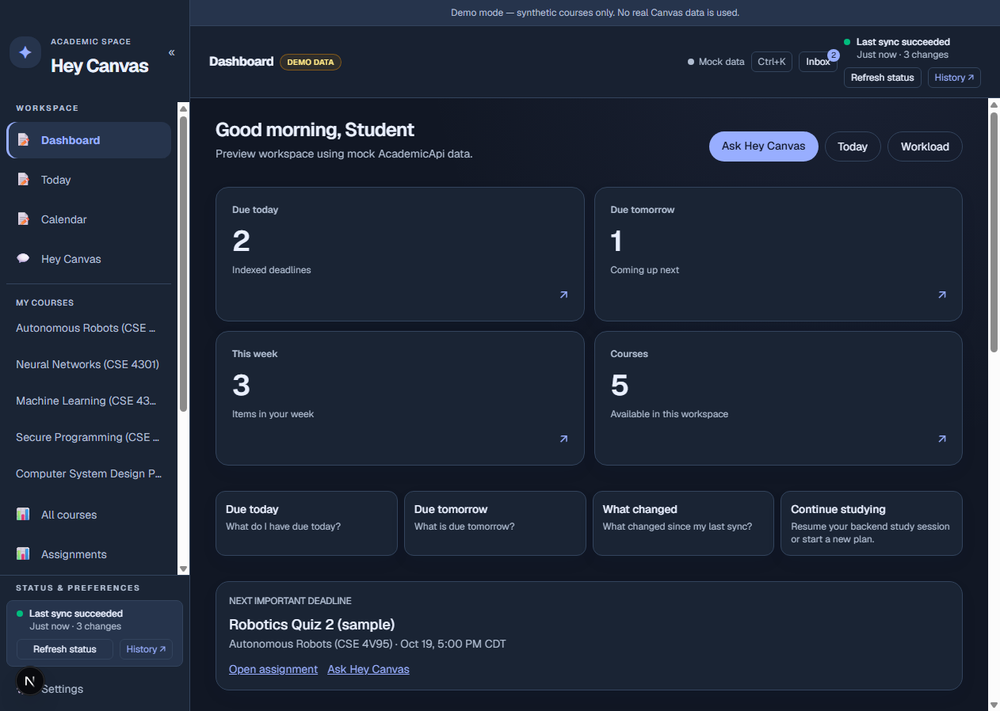
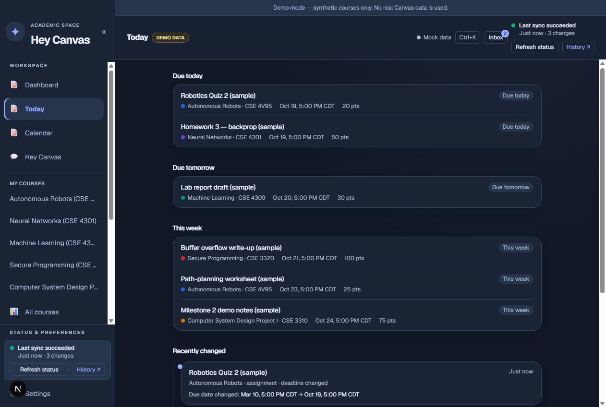
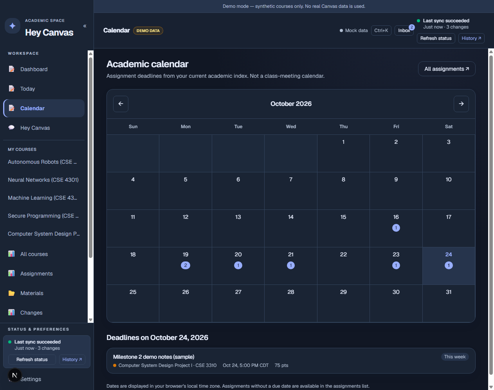
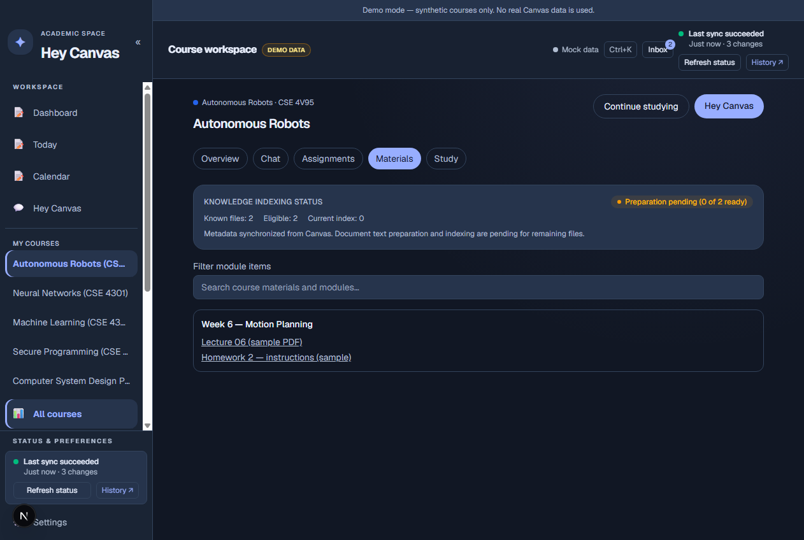
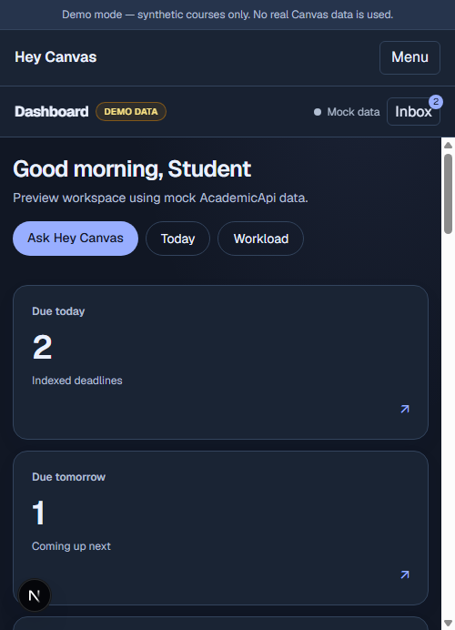

# Hey Canvas

**What if your AI study assistant actually understood your courses?**

As a computer science student, I found myself constantly switching between Canvas assignments, lecture notes, announcements, calendars, and AI chats just to understand difficult topics, connect them to what I was learning in class, and figure out what to study next.

Generic AI assistants can explain a concept, but they don't automatically know which course you're asking about, what your professor covered, or which deadline is approaching.

I built **Hey Canvas** to bring those experiences together.

It's a **local-first, course-aware AI academic copilot** that connects authorized Canvas information with an interactive study assistant—helping students understand concepts using supporting course materials, ask questions about deadlines, and decide what deserves their attention.

**Ask about your courses. Understand the material. Know what to work on next.**

[Explore the engineering case study →](PROJECT_STORY.md) · [Run the synthetic demo →](#local-development-windows) · [See how the AI works →](#how-the-ai-assistant-works)

> Independent student-built project, not affiliated with or endorsed by Instructure or any university. This is a locally tested release candidate, not a publicly hosted service.

## Meet the academic copilot

Imagine asking **“Can you explain forward kinematics for a two-link robotic arm using my course materials?”** instead of copying lecture notes into a separate chatbot. Or asking **“What's due this week, and what should I prioritize?”** instead of checking each course manually.

Hey Canvas connects academic questions to the **selected course, available records, and supported source evidence**. For structured questions, it can use deterministic logic; for explanations, it can optionally stream responses from a local Ollama model. It distinguishes retrieved course evidence from generated explanations rather than treating a model's guess as a verified professor instruction.

### AI assistant and course context



*Screenshot from the synthetic demo: a course-aware, prewritten example explanation with sample source references. Optional Ollama-powered generation is a separate application mode.*

### The academic workspace behind the answers

| Course overview | Today and priorities |
|:---:|:---:|
|  |  |

The dashboard, deadlines, and calendar are not the whole product: **they provide structured context for the assistant** so academic questions can be answered with reference to actual available records rather than disconnected chat history.

<details>
<summary>More application views: calendar, course materials, and mobile</summary>

| Deadline calendar | Course materials |
|:---:|:---:|
|  |  |



</details>

## How the AI assistant works

1. **Connect authorized course data.** Read-only Canvas synchronization brings course, assignment, deadline, and announcement records into local storage.
2. **Prepare available evidence.** Supported course files can be cached, text-extracted, and indexed within bounded preparation limits; not every Canvas file is automatically downloaded or searchable.
3. **Route the question.** Course selection, academic intent, and available records help determine which context belongs in an answer.
4. **Choose the response path.** Structured academic questions can use deterministic logic; explanatory questions may use an optional local Ollama model with retrieved evidence.
5. **Make the response inspectable.** Source-aware answers, streaming, cancellation, and clear unavailable-evidence states help users distinguish verified records from generated guidance.

```text
Authorized Canvas API (read-only)
            |
   Local sync + SQLite
            |
  Course records + supported files
            |
   Course-scoped retrieval
            |
   Academic intent routing
       /          \
Structured logic   Optional local Ollama
       \          /
  Source-aware assistant
            |
    Next.js study workspace
```

**Built with:** Next.js, React, TypeScript, Tailwind CSS, Python, FastAPI, SQLAlchemy, SQLite, and optional Ollama. [Architecture and design decisions →](PROJECT_STORY.md)

## What it does

- **Organizes academic work:** Course overview, assignments, calendar, upcoming deadlines, announcements, and synchronization status.
- **Synchronizes Canvas data safely:** Read-only API integration, guarded pagination and retries, secret redaction, and local SQLite persistence.
- **Prepares course knowledge:** Managed document cache, supported document text extraction, course-scoped retrieval, source provenance, incremental and bounded post-sync preparation, and coverage reporting.
- **Answers in context:** Deterministic responses for supported structured academic questions; optional Ollama-generated explanations with available course evidence.
- **Supports interactive study:** Streaming responses, Stop/retry controls, selected-course context, and browser-persisted conversations.
- **Runs locally:** Windows launcher, health/readiness checks, configurable application data directory, and storage inspection.

Not every Canvas file is downloaded or indexed. Retrieved text is treated as untrusted data, and generated academic answers still require verification.

## Architecture

```text
           Authorized Canvas LMS API (read-only)
                            |
                Guarded sync and validation
                            |
          FastAPI services + SQLAlchemy + SQLite
                 |                       |
      Courses / assignments       File metadata, cache,
      deadlines / announcements   text preparation / index
                 \                       /
                  Course-scoped context
                            |
           Academic intent + evidence orchestration
                 |                       |
         Deterministic logic      Local Ollama model
                 \                       /
              Source-aware assistant stream
                            |
          Next.js / React / TypeScript student UI
```

For additional implementation detail, see the [engineering case study](PROJECT_STORY.md) and [maintainable architecture diagram](docs/portfolio/architecture.mmd).

**Tech:** Python 3.12+, FastAPI, Pydantic, SQLAlchemy, SQLite, HTTPX, Next.js, React, TypeScript, Tailwind CSS, Ollama, pytest, Ruff, mypy, Vitest, ESLint, Playwright, and GitHub Actions.

## Engineering verification

The published release has a clean source-history baseline and automated checks on the current application snapshot. [GitHub Actions run #39676551978](https://github.com/sathwikpareedula/hey-canvas/actions/runs/39676551978) passed all five jobs on application commit `487b6fc`: history secret scan, frontend, backend, synthetic browser journeys, and Windows synthetic acceptance.

The release audit reported **1,083 backend tests passed**, **310 frontend tests passed**, and **zero findings** from Gitleaks history and tracked-file scans. Production-only dependency audit reported zero vulnerabilities; a development-only transitive `braces` advisory remained noted. These are recorded release results, not a guarantee of security or academic answer accuracy.

**The robotics screenshot uses the deterministic synthetic demo provider, not Ollama generation.** Optional Ollama-backed responses are a separate local mode. Earlier real-model evaluation had limitations, documented in [VERIFICATION.md](VERIFICATION.md).

## Local development (Windows)

**Prerequisites:** Python 3.12+, Node.js 22.13+ (or another compatible supported LTS version) and npm, and Ollama with a locally installed model if using AI generation.

```powershell
git clone https://github.com/sathwikpareedula/hey-canvas.git
cd hey-canvas
py -3.12 -m venv .venv
.\.venv\Scripts\python.exe -m pip install -e ".[dev]"
cd frontend
npm ci
cd ..
Copy-Item .env.example .env
```

Keep `.env` local and private. Configure an authorized Canvas connection through the app; for model-generated explanations, install Ollama and a compatible model separately. See the [complete Windows setup guide](docs/SETUP-WINDOWS.md) before using real academic data.

This repository contains the public V1.2 source snapshot on the default `main` branch. The original development repository remains private. Use a separate directory, isolated ports, and synthetic fixtures when evaluating a candidate alongside an existing installation. Avoid pointing two checkouts at the same real database.

Start through `launcher\windows\Start-HeyCanvas.cmd`; stop with `launcher\windows\Stop-HeyCanvas.cmd`. To inspect the interface with synthetic data, use `launcher\windows\Start-HeyCanvas-Demo.cmd` after completing installation. Demo content is not real Canvas data or evidence of model accuracy. The startup interface normally runs at `http://localhost:3001/startup`. Model downloads and browser microphone permissions are user controlled; no real Canvas credentials are needed for synthetic demos.

To run key checks:

```powershell
.\.venv\Scripts\python.exe -m pytest backend/tests
.\.venv\Scripts\python.exe -m ruff check backend
cd frontend
npm run lint
npm run typecheck
npm run test
npm run build
```

## License

MIT licensed. See [LICENSE](LICENSE). The project is independent of and not endorsed by Instructure; the license does not grant rights to Canvas or third-party course content.

## Documentation

- [Windows setup](docs/SETUP-WINDOWS.md) — clean installation, local AI, and first-run expectations.
- [Troubleshooting](docs/TROUBLESHOOTING.md) — startup, Canvas sync, database, and model issues.
- [Security and privacy](SECURITY.md) — intended security boundaries and responsible reporting.
- [Engineering case study](PROJECT_STORY.md) — design decisions, tradeoffs, and implementation.
- [Portfolio case study](docs/portfolio/portfolio_package.md) — executive summary, architecture, and technology stack.
- [Recruiter and LinkedIn guide](docs/portfolio/linkedin_and_resume.md) — project summary, resume bullets, and interview deep-dives.
- [Verification](VERIFICATION.md) — measured results, open risks, and test limitations.

## Privacy, limitations, and status

- Canvas operations are designed to be **read-only**. Keep tokens, databases, downloaded course files, local logs, and student records out of Git and public screenshots.
- Academic data is stored locally by default, and Ollama can run on loopback. **Canvas synchronization itself communicates with the Canvas service**, and browser speech features or optional external providers have separate privacy implications. No absolute zero-egress or regulatory-compliance claim is made.
- Supported files are prepared incrementally and within bounds; metadata availability is not proof of extracted or indexed content.
- Browser conversations persist in `localStorage`. Durable backend storage of completed chat messages is **not implemented** in this candidate.
- Real-model reliability is still being evaluated; the latest complete 22-case evaluation was **16/22**. Subsequent owner-device acceptance verified real streaming, cancellation before and after first text, follow-up requests, and structured failures; these do not establish general answer accuracy.
- Twelve frontend integration-marked tests were skipped in the recorded ordinary run. Fresh Windows clean-checkout startup/restart is verified in CI, but real Canvas authorization, Ollama inference and physical microphone permissions are not covered by that clean-install test. The development-only `braces` advisory remains open.
- Browser voice input remains experimental; physical microphone capture has not been accepted. A fresh real Canvas sync was not authorized during owner-device acceptance.
- **The V1.2 source repository is public.** There is no hosted production service, and the synthetic demo is not proof of local-model answer accuracy.

This project is a study and organization tool, not an automated exam taker, assignment submitter, or grading authority.